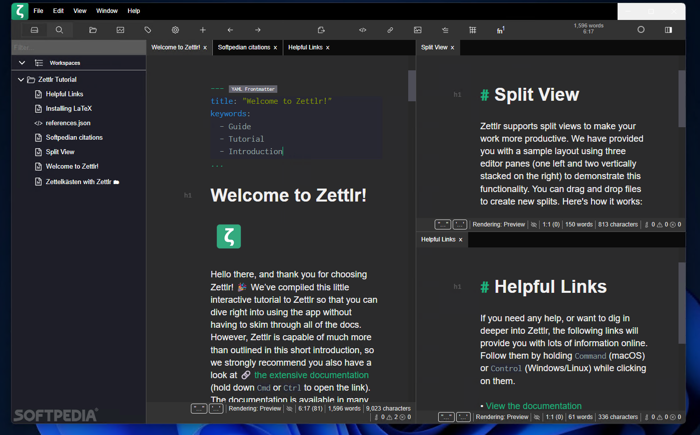
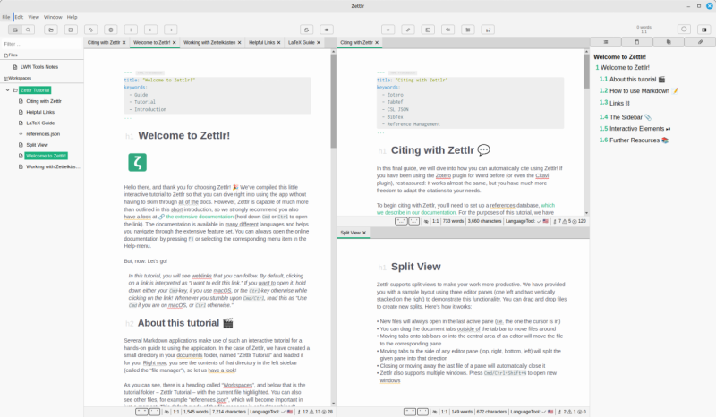
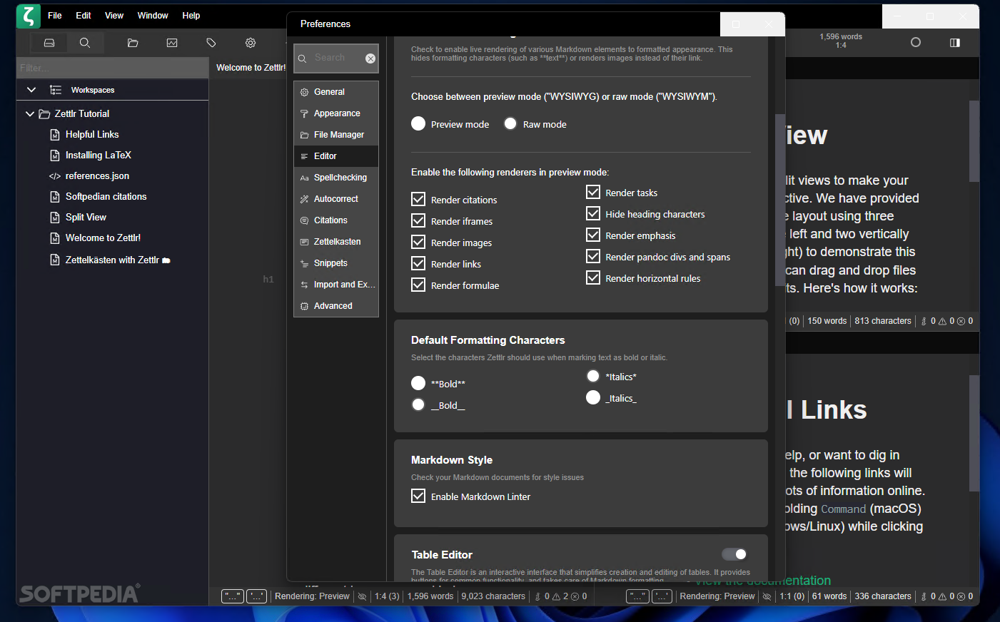

# Zettlr Research Notes, Connected and Ready for Publication

A useful research workspace keeps the argument close to the evidence.
Zettlr App works with local Markdown files, connecting reading notes, references, and manuscript preparation without requiring a cloud account.

[](https://zettlr-app.github.io/Zettlr/)

## Keep three kinds of writing within reach

Separate source notes, your own developing ideas, and text intended for a reader.
They can live in the same workspace while serving different purposes.

| Material | Main question | Useful contents | Ready to reuse when |
|---|---|---|---|
| Reading note | What does this source establish? | Citation key, location, summary | Evidence and interpretation are distinguishable |
| Concept note | How does this relate to another idea? | A claim, links, unresolved questions | The connection has an explanation |
| Manuscript section | What should the reader understand? | Ordered paragraphs and citations | The passage advances the argument |

This is an organizational approach you can adapt, not a required Zettlr folder structure.
Choose names that remain understandable outside the editor.

Open the folders you need as workspaces and keep related images and reference files in predictable locations.
A local file remains useful only if its dependencies can still be found.

The supplied [document-tree.spec.ts](test/document-tree.spec.ts) tests the application's document-tree structure.
The [disambiguate-file.spec.ts](test/disambiguate-file.spec.ts) file covers filename disambiguation when a destination name is already occupied.

## Connect notes with a reason for every link

A zettlr zettelkasten workflow can connect files by their names or by recognized identifiers.
Use stable identifiers when you expect a note's title to change as your understanding develops.

A short note might contain:

```markdown
A source summary should distinguish a reported result from my interpretation.

Related argument: [[20261117093000]]
#methods #reading
```

The identifier is an example of a note you would create or identify in your own workspace.
Its default timestamp shape is only useful when it matches the identifier pattern configured in Zettlr.

Explain the relationship near the link.
"Contradicts the sampling assumption" gives a later reader more information than an unexplained list of related files.



Use tags for a recurring context or topic, and links for a specific relationship.
Avoid creating several tags that describe the same concept with slightly different wording.

The [Zettelkasten guide](https://docs.zettlr.com/en/pkms/zkn-method.html) explains identifiers, links, and keywords.
The supplied [replace-links.spec.ts](test/replace-links.spec.ts) covers internal-link replacement, while [replace-tags.spec.ts](test/replace-tags.spec.ts) covers tag replacement.

For graph implementation examples, [graph.spec.ts](test/graph.spec.ts) tests directed relationships.
A graph can reveal a connection to inspect; it cannot decide whether that connection supports your argument.

## Return to a claim through search

Write notes with the words you are likely to remember later.
A descriptive sentence often helps retrieval more than an elaborate naming system alone.

Try a search as soon as a small collection begins to grow:

1. Search for a central term from an earlier note.
2. Narrow the result using another concept.
3. Open a promising result and inspect its context.
4. Follow its links to check whether the trail remains useful.

Check the difference between matching every term and matching either term.
For example, a query for two concepts can be much narrower than a query that accepts either one.

The supplied [compile-search-terms.spec.ts](test/compile-search-terms.spec.ts) includes Boolean-query cases.
The [make-search-regex.spec.ts](test/make-search-regex.spec.ts) file tests how search text becomes a regular expression.

Search scope matters as much as query wording.
The [ignore-path.spec.ts](test/ignore-path.spec.ts) tests path exclusions used by the application.

## Let the reference library carry bibliographic detail

Keep source records in a reference manager and cite them with stable citation keys.
Check the author, title, date, and publication details before using a record in a manuscript.

For Zotero, Zettlr's documented integration uses an exported library maintained by Better BibTeX.
The current guide recommends Better CSL JSON with Keep updated enabled; Better BibTeX and Better BibLaTeX are also supported.

Select that exported library in Zettlr's citation preferences.
After changing a source record in Zotero, confirm that the updated information reaches the library file and appears in Zettlr.

Insert a citation using the key from your own library.
A marker such as `[@yourKey]` requires a matching reference record before it can produce a useful citation.



Use the [reference-manager integration guide](https://docs.zettlr.com/en/guides/reference-manager-integration.html) for the complete connection.
The supplied [extract-bibtex-attachments.spec.ts](test/extract-bibtex-attachments.spec.ts) tests attachment-path extraction from BibTeX data.

A source attachment, a citation record, and an in-text citation serve different roles.
Retain the attachment when you need to revisit the evidence, and retain the bibliography data when you need to render citations.

## Give the manuscript its own metadata

The zettlr markdown editor keeps document metadata in a YAML front matter block.
Place it at the beginning of the manuscript and choose values that match the intended document.

This example names a bibliography file for a manuscript:

```yaml
---
title: "Field notes on urban shade"
author:
  - Morgan Lee
lang: en-US
bibliography: references.bib
---
```

The title and author are illustrative values.
The bibliography must point to an existing file containing the records cited by the manuscript.

The [YAML front matter guide](https://docs.zettlr.com/en/syntax/yaml-frontmatter.html) distinguishes document metadata from export-profile settings.
The supplied [extract-yaml-frontmatter.spec.ts](test/extract-yaml-frontmatter.spec.ts) tests metadata extraction.

### Rearrange the argument before polishing sentences

Use headings to express the document's structure.
Move a section when it belongs elsewhere in the explanation, then check its opening and closing transitions.

The supplied [move-section.spec.ts](test/move-section.spec.ts) covers heading-section movement.
The [snippets.spec.ts](test/snippets.spec.ts) file tests reusable insertion templates and their selection positions.

For a comparison that genuinely needs rows and columns, use the table editor.
Keep the table small enough that its relationships remain readable in the intended output format.

The [build-pipe-table.spec.ts](test/build-pipe-table.spec.ts) file covers Markdown table construction.
The [table-editor-rows.spec.ts](test/table-editor-rows.spec.ts) file tests row insertion behavior.

### Apply text transformations to a deliberate selection

Normalize copied text after checking what the transformation will change.
Preserve meaningful line breaks in poetry, code, addresses, and similar material.

The supplied text-transformation tests provide concrete behavior examples:

- [strip-duplicate-spaces.spec.ts](test/transform-selected-text/strip-duplicate-spaces.spec.ts) covers repeated-space removal.
- [remove-line-breaks.spec.ts](test/transform-selected-text/remove-line-breaks.spec.ts) covers joining selected lines.
- [straighten-quotes.spec.ts](test/transform-selected-text/straighten-quotes.spec.ts) covers straight quotation marks.
- [to-sentence-case.spec.ts](test/transform-selected-text/to-sentence-case.spec.ts) covers sentence-case transformation.

Re-read the result after a transformation.
A mechanically consistent quotation style still needs to preserve the meaning of a quotation.

## Make an export small enough to inspect thoroughly

Before exporting a long manuscript, try a representative section with a citation, a table, an image, and any required mathematics.
Inspect the result in the application your reader will use.

Zettlr's standard exporter prepares settings and invokes Pandoc.
Projects can combine several input files in a configured order and export using multiple profiles.

The [export workflow guide](https://docs.zettlr.com/en/export/workflow.html) explains these steps.
The supplied [pandoc-reader-writer.spec.ts](test/pandoc-reader-writer.spec.ts) covers format names and enabled or disabled reader extensions.

For a separate command-line conversion, this is a Pandoc command:

```bash
pandoc manuscript.md --citeproc -o manuscript-review.docx
```

It assumes Pandoc is available on the command path and the manuscript names an accessible bibliography, such as the front matter above.
It uses Pandoc directly; Zettlr's selected export profile and preprocessing are not automatically applied.

The [Pandoc manual](https://pandoc.org/MANUAL.html) documents conversion and citation processing.
PDF output additionally needs the engine and supporting tools required by the chosen export route.



Check the exported artifact for:

- Correct citation keys and bibliography entries.
- Heading hierarchy and section order.
- Tables that fit the page or viewport.
- Images with available source files.
- Mathematical notation and special characters.
- Links that make sense to a reader outside your note collection.

The supplied [markdown-to-ast.spec.ts](test/markdown-to-ast.spec.ts) tests Markdown parsing.
The [markdown-to-html.spec.ts](test/markdown-to-html.spec.ts) file covers HTML conversion behavior.

## Try another configuration without moving the research

For a separate Zettlr configuration, the application supports a custom data directory.
This can be useful when evaluating preferences for a review-oriented writing session.

On Windows, with Zettlr.exe available on the command path, PowerShell can launch it with a writable configuration location:

```powershell
$reviewProfile = Join-Path $env:LOCALAPPDATA 'Zettlr-Review'
& Zettlr.exe "--data-dir=$reviewProfile"
```

The data-directory switch selects application configuration storage.
It is not a command to relocate your Markdown workspace or export a manuscript.

The official [README command-line section](https://github.com/Zettlr/Zettlr/blob/develop/README.md#command-line-switches) documents this option.
The supplied [package.json](package.json) identifies the application and its development scripts.

For readers exploring zettlr open source, [LICENSE](LICENSE) contains the GPLv3 terms.
Use [CHANGELOG.md](CHANGELOG.md) to distinguish release information from changes listed under Upcoming.

The linked files are selected Zettlr tests and project metadata, not a complete buildable checkout.
The note identifiers, manuscript, and bibliography filenames in the examples refer to material you supply; the conversion command belongs to Pandoc.

## Related Search Terms

Zettlr App, Zettlr, zettlr markdown editor, zettlr zettelkasten, zettlr open source, markdown, note-taking, pandoc, productivity, offline, electron, docx, pdf, desktop, zettlr
